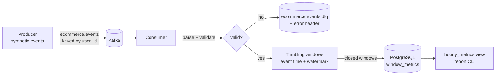

# Real-time E-commerce Streaming Pipeline

[](https://github.com/kaajjalchoudhary/realtime-ecommerce-streaming/actions/workflows/ci.yml)


A streaming pipeline that ingests clickstream and order events from Kafka, validates them, aggregates
them into **event-time tumbling windows with watermarks**, and stores per-minute funnel metrics
(page views → add-to-cart → purchase, revenue, unique users, conversion rate) in PostgreSQL.
Bad messages are routed to a **dead-letter topic** instead of crashing the consumer.

## Architecture



## Key concepts demonstrated

| Concept | Where |
|---|---|
| Event-time windowing (not processing time) | `windowing.py` aligns each event to `floor(event_time / window)` |
| Watermarks and late data | the watermark is tracked **per partition** and the overall watermark is the minimum (as in Flink), so a partition read ahead of the others can't make their events late; windows close when the watermark minus `allowed_lateness` passes their end |
| Schema validation and dead-letter queue | `events.py` rejects malformed JSON, missing fields, unknown types and negative prices; `consumer.py` forwards them to the DLQ with the reason in a Kafka header |
| Delivery semantics | auto-commit is off; offsets are committed only after closed windows are written |
| Idempotent sink | `INSERT ... ON CONFLICT (window_start) DO UPDATE`, so replays don't create duplicates |
| Partitioning | events are keyed by `user_id`, so a user's events stay ordered within a partition |

## Quick start

Requires Docker and Python 3.9+.

```bash
git clone https://github.com/kaajjalchoudhary/realtime-ecommerce-streaming.git
cd realtime-ecommerce-streaming
python -m venv .venv && source .venv/bin/activate
make install

make up        # Kafka (KRaft, no ZooKeeper) + PostgreSQL
make produce   # 3,000 events spread over the last 15 minutes, ~2% deliberately broken
make consume   # aggregate and write windows, exits after 15s of inactivity
make report    # print the latest windows
make down
```

Real output from the CI integration run (3,000 events, 59 deliberately broken):

```
consumer INFO Assigned partitions [0, 1, 2]
consumer INFO window 2026-10-24 12:45  views=146 carts=24 purchases=7 revenue=1602.50 users=156
consumer INFO window 2026-10-24 12:46  views=162 carts=22 purchases=14 revenue=2577.50 users=159
consumer INFO window 2026-10-24 12:47  views=162 carts=22 purchases=12 revenue=1742.50 users=166
...
consumer INFO Finished: {'consumed': 3000, 'valid': 2941, 'dead_lettered': 59, 'windows_written': 16, 'late_events': 0}
```

Every valid event lands in a window, every broken one goes to the DLQ, and nothing is dropped as late.

For a live stream instead of a backfill, run the consumer in one terminal and
`PYTHONPATH=src python -m streaming.producer --events 100000 --rate 50` in another.

Everything is configurable with environment variables (`KAFKA_BOOTSTRAP_SERVERS`, `POSTGRES_DSN`,
`WINDOW_SECONDS`, `ALLOWED_LATENESS_SECONDS`, ...), see `config.py`.

## Testing

- **Unit tests** (`make test`): event validation, every DLQ failure mode, window alignment, watermark
  behaviour across partitions, rebalances, out-of-order and late events.
- **Integration test** (CI): starts Kafka and PostgreSQL with Docker Compose, produces 3,000 events,
  runs the consumer and asserts that at least 10 windows and 2,800 events land in the database.

> The integration test earned its place: the first version used a single global watermark, and CI
> showed that only about a third of the events were aggregated. Kafka hands the consumer a batch from
> one partition at a time, so that partition pushed the watermark ahead and the other partitions'
> events were dropped as "late". Switching to per-partition watermarks fixed it.

## Project structure

```
├── src/streaming/
│   ├── producer.py     # synthetic event generator + topic creation
│   ├── consumer.py     # poll loop, DLQ routing, offset management
│   ├── windowing.py    # tumbling window aggregator with watermark
│   ├── events.py       # Event model, validation, test-data generator
│   ├── sink.py         # PostgreSQL upserts
│   ├── report.py       # query CLI
│   └── config.py
├── sql/init.sql        # tables + hourly rollup view
├── tests/
├── docker-compose.yml
└── .github/workflows/ci.yml
```

## Limitations and next steps

- Window state lives in memory. If the consumer crashes, events from windows that were still open
  when offsets were last committed are not replayed. Kafka Streams, Flink or Spark Structured
  Streaming solve this with checkpointed state stores.
- Add a schema registry (Avro/Protobuf) instead of JSON validation.
- Expose consumer lag and DLQ rate as Prometheus metrics.
